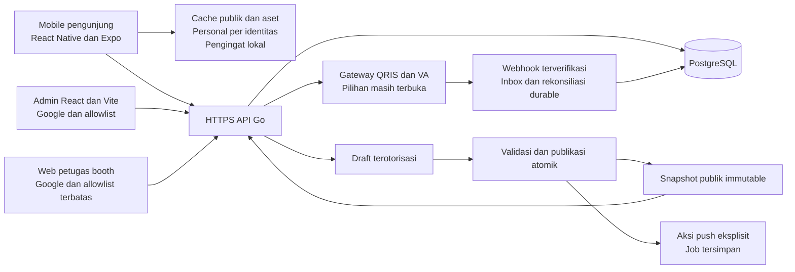

# Baseline teknis Pespor

Dokumen terkait: [PRD](PRD.md), [UX](UX.md), [Delivery dan penerimaan](DELIVERY.md), [Keputusan dan dependensi](DECISIONS.md), [Indeks](README.md).

## 1. Status dan batas kewenangan

- **Keputusan produk:** aplikasi Pestapora untuk pengunjung, Android dahulu, bahasa Indonesia, satu edisi aktif; Google opsional untuk informasi/favorit/jadwal tetapi wajib untuk checkout dan riwayat shop. Admin web terpisah memiliki operator serta petugas booth terbatas; backend memeriksa masing-masing allowlist. Konten memakai draft → terbit; tiket tetap link kanal resmi. Shop merchandise resmi satu pengelola wajib rilis pertama, bukan transaksi tenant atau marketplace. FR-01–FR-15 mengikuti [PRD](PRD.md).
- **Snapshot implementasi:** bagian 2 merekam pembacaan statis saat baseline disusun pada 16 Oktober 2026, bukan status terkini otomatis atau bukti runtime. Periksa manifest/source terbaru sebelum mengerjakan implementasi. Komentar referensi bukan bukti reverse engineering.
- **Kontrak target:** bagian 3–10 adalah acuan implementasi baseline, bukan proposal yang boleh dipilih sebagian. PRD memiliki scope, UX memiliki interaksi, dan dokumen ini memiliki data/protokol. Rincian ini bukan klaim seluruh detail dipilih eksplisit pengguna atau sudah tersedia di kode; aturan konflik mengikuti README.

Stamp/check-in/reward, pemilih banyak festival, shell UI yang dikendalikan CMS, GPS/rute, keramaian realtime, dan tiket internal **di luar scope rilis pertama**. Kode prototype yang menyebutnya bukan persetujuan fitur; dokumen ini tidak mengubah kode.

## 2. Snapshot implementasi saat penyusunan — nonnormatif

### 2.1 Stack dan konfigurasi teramati

| Area | Sumber/simbol | Fakta statis dan implikasi |
| --- | --- | --- |
| Backend | `backend/go.mod` | Mendeklarasikan `go 1.26.0`, `pgx/v5`, Firebase Admin Go, dan Google API. Versi ini deklarasi manifest, bukan toolchain yang telah diuji. |
| HTTP/database | `backend/cmd/server/main.go:main`, `backend/internal/api/server.go:New` | `net/http` dan PostgreSQL/pgx; startup menerapkan migrasi, seed hanya jika `SEED=1`. `DATABASE_URL`, `ADDR`, `FCM_CREDENTIALS` adalah konfigurasi yang dibaca. Default lokal bukan konfigurasi produksi. |
| Mobile | `mobile/package.json` | React Native 0.74.2, React 18.2, Expo ~51, TypeScript; React Navigation, Zustand, AsyncStorage, NetInfo, `expo-notifications`, `react-native-svg` sudah dideklarasikan. `start` memakai development client. Tidak perlu mengganti state/navigation/database untuk baseline ini. |
| Native/izin | `mobile/app.json` | Mendeklarasikan package `id.pespor.app`, skema `pespor`, izin notifikasi/exact alarm, juga kamera/NFC/lokasi; plugin `expo-build-properties` disebut di konfigurasi. Ini tidak membuktikan permission diberikan atau plugin tersedia. Kamera/NFC/lokasi tidak dibutuhkan scope rilis; konfigurasi harus dirapikan saat implementasi, bukan dijadikan alasan menambah fitur. ID produksi dan signing tetap perlu konfirmasi. |
| Penyimpanan aset | `mobile/pnpm-lock.yaml` entri `expo-file-system@17.0.1`; `mobile/package.json` | File system Expo terdapat sebagai dependensi transitif di lockfile, belum dependensi langsung aplikasi. Gunakan kemampuan Expo yang sudah tersedia untuk cache file; deklarasi langsung/kompatibilitas SDK harus diselesaikan bila diimpor, bukan menambahkan mesin penyimpanan baru. |
| Shell | `mobile/src/App.tsx:App`, `SCREENS` | Tab/tema berasal dari `app_layout`, alias stamp masih ada. Target adalah navigasi tetap sesuai UX Pespor, bukan shell kustom dari CMS. |
| Admin | inventaris direktori proyek saat pembacaan | Belum ada aplikasi admin terpisah dalam inventaris yang dibaca. React + TypeScript + Vite adalah target yang disepakati, bukan implementasi teramati. |

### 2.2 API dan data existing — bukan kontrak target yang aman

Route berikut benar-benar didaftarkan oleh `backend/internal/api/server.go:New`. DTO dan SQL ada di `content.go`/`actions.go`; skema ada di `backend/migrations/0001_init.sql`.

| Existing | Perilaku statis | Gap terhadap baseline |
| --- | --- | --- |
| `GET /healthz` | Mengembalikan 200. | Bukan readiness/hasil verifikasi database atau integrasi. |
| `GET /v1/festivals` | `listFestivals` mengambil semua festival, urut waktu mulai menurun, termasuk `purchase_url`. | Tidak ada pemilihan edisi aktif eksplisit. Mobile `bootstrap` mengambil elemen pertama. |
| `GET /v1/festivals/{id}/app_layout` | `appLayout` membaca tema, tab dan tombol. | Bukan kebutuhan shell target; belum publikasi draft yang terisolasi. |
| `GET /v1/festivals/{id}/revisions` | `revisions` mengembalikan peta entity → integer. | Belum satu publication konsisten lintas entity. |
| `GET /v1/festivals/{id}/content/{entity}?since=N` | `content` mendukung `artist`, `stage`, `timetable`, `map`, `news`, `stamp_rally`; respons `{revision,items}`. | Walau komentar menyebut delta, `fetchArtists` dan fetcher sejenis memfilter **revision entity**, bukan perubahan per row. Ketika revision lebih besar, seluruh koleksi dikembalikan; jika tidak, array kosong. Tidak ada tombstone/delta row. Pembacaan current revision dan isi tidak dalam snapshot transaksi yang sama. |
| `POST /v1/festivals/{id}/watch` dan `/favorites` | `setWatches`/`setFavorites`: body `{user_id,slots:[...]}` atau `{user_id,artists:[...]}`; hapus-lalu-insert dalam transaksi; balas `{ok:true}`. | Caller memilih identitas; tidak ada token auth/CAS/GET pemulihan akun. Validasi keterikatan ID dengan edisi belum memadai. Ini **risiko BOLA**: mengganti `user_id` dapat menyasar data orang lain; device ID bukan autentikasi. Tidak boleh diekspos sebagai API personal produksi. |
| `POST /v1/push/register` | `registerPush` menerima `token,user_id,festival_id,platform` dan upsert token. | Identitas dipercaya dari body; belum lifecycle instalasi, unregister atau bukti transport mobile/backend cocok. |
| `POST /admin/festivals/{id}/push` | `push.Sender.AdminHandler` memanggil broadcast. | Komentar menyebut proteksi header produksi, tetapi handler/router yang dibaca tidak menerapkan autentikasi maupun allowlist. Jangan menganggap sudah terlindungi. |
| `POST /v1/stamp/checkin`, `GET /v1/stamp/status` | Route dan handler tersedia. | Di luar rilis; tidak diwariskan ke kontrak target. |

Skema existing mencakup `festivals`, `revisions`, `app_layout`, `app_tabs`, `home_buttons`, `artists`, `stages`, `timetable_slots`, `user_favorites`, `user_watches`, `map_floors`, `map_points`, `news`, tabel stamp/congestion/push dan `revision_log`. Belum ada tabel akun/sesi, allowlist operator, tenant mandiri, artikel informasi penting/FAQ, publikasi immutable, draft revision, atau job push idempoten di migrasi yang dibaca. `timetable_slots.artist_ids` adalah array BIGINT, bukan foreign key per penampil; `stage_id` dan `floor_id` mempunyai FK tetapi tidak memastikan kesamaan `festival_id`. Validasi lintas edisi wajib ditambahkan. `news.publish_at` sendiri bukan status publikasi: `fetchNews` tidak memfilter draft atau waktu terbit. `fetchStampRallies` bahkan mengekspor row generik termasuk atribut internal; target harus memakai DTO publik ber-allowlist field, bukan `to_jsonb(row)` tanpa seleksi.

`backend/internal/sync/revision.go:BumpRevision` hanya helper menaikkan revisi entity. Keberadaannya bukan bukti alur edit/publish/admin selesai; router yang dibaca belum menyediakan CRUD konten admin.

### 2.3 Mobile existing dan gap offline/personal

| Sumber/simbol | Pengamatan dan gap |
| --- | --- |
| `mobile/src/store.ts:ensureUserId`, `bootstrap` | Membuat `dev_...` acak di AsyncStorage dan mengirim identitas itu ke backend. `bootstrap` menunggu `api.festivals()` **sebelum** `restoreCache()`: cold start offline belum memenuhi FR-07. Metadata festival tidak dipulihkan dulu dari cache. |
| `store.ts:toggleFavorite`, `toggleWatch` | Set diperbarui di memori dan POST dilakukan fire-and-forget; favorit/watch belum dipersist/direstore sebagai state personal. Request paralel bisa saling menimpa. Tidak ada Google login atau pemulihan akun pada alur ini. |
| `mobile/src/sync.ts:syncAll`, `restoreCache` | AsyncStorage JSON per entity; entity diganti dengan hasil full fetch. Key `rev`, `ent:*` belum namespace edisi/schema. Beberapa entity ditulis sebelum seluruh unduhan berhasil; pointer publikasi/commit atomik belum ada. |
| `sync.ts:enqueue`, `flushQueue` | Antrean global `mutation_queue` menyimpan snapshot watch/favorite/checkin; gagal dipertahankan, tetapi tidak terikat principal/edisi per item secara aman. Belum base revision, CAS, proteksi konflik, atau isolasi logout. |
| `mobile/src/screens/MapScreen.tsx:MapScreen` | Gambar URL jaringan dan pin koordinat pixel; `ScrollView` memberi properti zoom. Belum unduh/verifikasi aset dan pencarian; keberadaan properti zoom bukan bukti pinch/pan bekerja pada Android. |
| `mobile/src/alerts.ts:scheduleSlotAlert`, `cancelSlotAlert` | Lead time existing **10 menit**, bukan keputusan 15 menit. Izin diminta dan jadwal `slot_ID` dibuat/dibatalkan; belum rekonsiliasi ketika jadwal terbit berubah. |
| `mobile/src/screens/TimetableScreen.tsx:TimetableScreen` | Toggle memanggil schedule/cancel; slot batal masih memiliki tombol toggle. Jam dirender dengan potongan string, belum konversi zona festival eksplisit. Tidak ada penghitungan konflik pilihan pada komponen ini. |
| `mobile/src/api.ts:api` | Client fetch tanpa bearer/session, tipe festival belum memuat `purchase_url` meskipun backend mengirimnya. Kontrak auth/personal target harus dimigrasikan pada seluruh caller, bukan hanya mengganti server. |
| `backend/internal/push/push.go:New`, `Broadcast` | Firebase FCM data message existing; tanpa kredensial hanya log dry run. Tidak ada bukti penerimaan/background handler mobile dari keberadaan sender ini. |

### 2.4 Batas snapshot terhadap shop

Bagian 2 dipertahankan sebagai catatan sumber historis, bukan inventaris ulang kode untuk perluasan shop. Kontrak shop di bawah adalah **target belum tersedia**, bukan klaim hasil pemindaian source baru atau integrasi gateway yang sudah berjalan. Tidak ada bukti sandbox, pembayaran, refund, atau validasi pickup dari snapshot ini.

## 3. Arsitektur target minimum dan cakupan FR



Tidak perlu microservice, database mobile baru, broker pesan, GraphQL, event sourcing, atau framework HTTP tambahan. Snapshot penuh per entity cukup untuk konten; harga/stok/pesanan adalah state transaksi live di PostgreSQL, tidak mengikuti publication. Backend yang sama menangani gateway HTTPS, webhook, dan rekonsiliasi durable sederhana; gateway QRIS/VA belum dipilih. Web admin/petugas tidak berada dalam mobile pengunjung. Penyimpanan file/hosting dan transport push belum dipilih; diagram menunjukkan batas tanggung jawab, bukan vendor.

| FR | Tanggung jawab teknis target |
| --- | --- |
| FR-01 | Satu pointer edisi aktif; metadata home, kanal resmi, jam/zona festival. Tidak ada pemilih atau arsip edisi di UI. |
| FR-02 | Snapshot penampil, daftar/detail/search lokal dan favorit terpersist. |
| FR-03 | Slot terikat hari/panggung/penampil; pilihan pribadi, konflik interval, reminder lokal 15 menit. |
| FR-04 | Ilustrasi versioned + pin, pencarian lokal, zoom/pan Android dan cache aset; tidak meminta GPS. |
| FR-05 | Artikel penting/FAQ/bantuan dan pengumuman published; push hanya pemicu informasi/refresh best effort. |
| FR-06 | Tenant makanan/merch kategori/lokasi dan relasi pin; tidak ada transaksi tenant. Shop resmi FR-11–FR-15 adalah domain terpisah. |
| FR-07 | Restore sebelum jaringan, commit cache konsisten, stale/error jujur, guest tidak cloud sync. |
| FR-08 | Google opsional untuk festival, wajib checkout/riwayat shop; identitas server-side, pemulihan/sinkron akun, isolasi data dan lifecycle akun. |
| FR-09 | URL tiket resmi HTTPS yang divalidasi; link-out. Integrasi tiket resmi kemudian tidak dibangun di baseline ini. |
| FR-10 | Operator allowlist, draft terisolasi, conflict detection, publish coherent, upload aset, push eksplisit idempoten. |
| FR-11 | Produk resmi terbit, varian ukuran/warna dan SKU, keranjang lokal guest; harga/ketersediaan terkini hanya dari server online. |
| FR-12 | Google, total IDR server, reservasi atomik, QRIS dan VA, status pembayaran tepercaya dan pemulihan checkout ambigu. |
| FR-13 | Riwayat milik pembeli, referensi/QR pesanan terotorisasi, pickup lengkap satu kali di satu booth resmi dengan validasi online. |
| FR-14 | Permintaan batal pesanan dibayar sebelum pickup, persetujuan operator untuk refund penuh; no-show refund penuh, blok pickup dan rekonsiliasi. |
| FR-15 | Operator produk/harga/stok/pesanan/refund; petugas booth hanya pencarian/pemeriksaan pickup yang diperlukan dan pencatatan serah-terima. |

## 4. Model data target

Nama berikut merupakan **rancangan migrasi baru**, bukan tabel/kolom yang sudah tersedia. Pertahankan ID konten existing yang valid saat migrasi; jangan mengubah migrasi yang telah diterapkan. Mobile memperlakukan ID stabil sebagai identitas, bukan urutan tampil.

### 4.1 Konten dan integritas

| Model | Field/aturan minimum |
| --- | --- |
| Edisi | ID, nama, rentang waktu, `timezone` IANA, venue, tautan web/tiket resmi, kontak bantuan, referensi aset home; pointer tunggal `active_edition`. Tanggal/zona/venue resmi masih prasyarat konten, jangan isi tebakan. |
| Artist / stage | Gunakan kolom relevan `artists`/`stages`; ID, nama, deskripsi aman, gambar, urutan. Hidden artist tidak bocor ke daftar publik; referensi slot harus tetap terdefinisi dalam snapshot atau publikasi ditolak. |
| Slot | ID, stage, daftar artist, `performance_date`, `start_at`, `end_at`, judul opsional, `is_cancelled`. Timestamp RFC3339 ber-offset/UTC, simpan TIMESTAMPTZ; zona edisi untuk tampilan. Target slot pertunjukan wajib punya akhir > mulai agar konflik dapat dihitung. `performance_date` adalah hari program, tidak selalu tanggal kalender setelah tengah malam. |
| Map floor | ID, nama, asset ID immutable, lebar/tinggi positif, urutan. Ilustrasi pixel saja untuk rilis. |
| Map point | ID, floor, tipe/kategori, nama, keterangan, x/y dalam batas gambar; relasi opsional ke stage/tenant. Semua relasi berada dalam edisi sama. |
| Tenant | ID, nama, kategori makanan/merch, deskripsi singkat, gambar opsional, pin/lokasi. Tidak ada harga wajib, stok, keranjang atau order. |
| Information | ID, kategori FAQ/aturan/bantuan/info penting, judul, isi, urutan; kontak bantuan dapat dirujuk dari metadata. Konten teks aman; format rich text terbatas bila diperlukan, bukan HTML/skrip bebas. |
| Announcement | ID, judul, isi, waktu publikasi, jenis umum/perubahan jadwal, referensi slot opsional; tampil setelah publish. Perubahan slot dan pengumuman terkait bisa masuk satu publication. |
| Asset | ID, URL immutable, SHA-256, ukuran byte, MIME, dimensi bila gambar, status upload siap; tidak menimpa isi URL yang telah dipublikasikan. |

Tambahkan constraint/validasi untuk referensi edisi yang sama, ID unik, urutan deterministik, panjang input, koordinat, end > start, dan kategori yang diizinkan. Validasi slot artist array secara eksplisit atau migrasikan ke tabel relasi FK yang sederhana; jangan mengandalkan tipe array sebagai validasi. Bentrok waktu pilihan **pengunjung** bukan error server; konflik jadwal antar slot/panggung ditunjukkan ke operator sebelum publish untuk koreksi, tanpa mengarang aturan operasional festival.

### 4.2 Draft, publication, akun dan personal

- `edition_drafts`: satu workspace per edisi, `draft_revision` monoton; tabel konten kerja tidak langsung dibaca endpoint publik.
- `publications`: ID/revision monoton per edisi, waktu terbit, operator, draft revision sumber; manifest immutable. `published_entities`: JSON snapshot penuh per entity untuk publication tersebut; `published_assets`: inventaris file yang direferensikan. Snapshot boleh merujuk bytes entity lama yang identik; jangan membangun delta row dulu.
- Pointer `current_publication` diganti dalam transaksi yang sama dengan snapshot/manifest. Skema relational existing dapat menjadi workspace draft setelah migrasi, tetapi endpoint publik existing harus dipindahkan ke snapshot publik agar edit tidak bocor.
- `accounts`: ID internal dan pasangan provider Google/`sub` unik; email profil bukan kunci identitas. `sessions`: principal, masa berlaku, revocation dan token hash; jangan simpan bearer mentah di DB/log.
- `operator_allowlist` dan `booth_allowlist`: email Google terverifikasi, dikelola tim teknis; bukan CRUD role bertingkat di UI. Sesi menyimpan principal akun, bukan hak yang dipercaya selamanya. Setiap request memeriksa akun aktif serta izin/allowlist saat itu; akun Google biasa tidak memiliki izin petugas. Hak booth tidak mewarisi hak operator, dan hak operator tidak otomatis memberi hak serah-terima tanpa allowlist booth.
- `personal_state`: `(account_id,edition_id)` unik, `revision`, himpunan `favorite_artist_ids` dan `selected_slot_ids`. Tabel favorites/watches existing dapat dipakai kembali setelah migrasi integritas akun/edisi; update himpunan dan revision satu transaksi. Referensi personal ke konten yang ditarik harus tetap dikenali melalui identitas arsip minimum (ID, edisi, label terakhir, status ditarik), bukan dihapus cascade. Ini bukan arsip edisi di UI. Preferensi pengingat dan ID notifikasi bersifat per perangkat, tidak disinkronkan ke cloud.
- `push_installations`: instalasi/token/platform/edisi/consent, akun opsional. Guest boleh berlangganan pengumuman tanpa mengirim favorit atau membuat akun cloud. Secret instalasi membuktikan hak rotasi/unregister token; jangan menerima `user_id` arbitrer.
- `push_jobs`: publication/announcement, operator, idempotency key, payload canonical, status, percobaan; unique key mencegah pengiriman ulang akibat retry aksi UI. Bukan jaminan exactly-once delivery provider.

### 4.3 Shop resmi: data live dan snapshot finansial

Nama model berikut **target**, bukan skema existing. Shop tunggal merchandise resmi terikat edisi; bukan merchant/artis/tenant marketplace. Penjualan sebelum dan selama festival, pickup lengkap satu kali di satu booth resmi; tidak ada pengiriman, pickup parsial, transfer pesanan, promo/voucher, cicilan, COD, bayar di booth, retur atau tukar mandiri.

| Model target | Field/aturan minimum |
| --- | --- |
| Produk dan varian | Konten produk draft/terbit: ID stabil, judul, deskripsi, aset, pilihan ukuran/warna dan relasi SKU. Kombinasi ukuran/warna unik per produk, SKU unik dan tidak digunakan ulang untuk barang berbeda. Produk hanya dapat dibeli setelah konten terbit serta SKU live valid; penarikan produk tidak mengubah pesanan lama. |
| `shop_skus` / harga live | SKU, edisi, atribut varian stabil, status penjualan, harga satuan integer IDR nonnegatif, revision. Harga bukan angka floating point atau field yang dipercaya dari cart. Harga/stok tidak dimasukkan publication immutable; publikasi konten tidak mengembalikan harga/stok lama. Perubahan makna varian yang sudah dipesan memakai SKU baru, bukan mengubah snapshot pesanan. |
| `shop_stock` / ledger | Per SKU: jumlah layak jual yang dikuasai, jumlah direservasi, jumlah dialokasikan pesanan dibayar, revision; tersedia = dikuasai − reservasi − alokasi, seluruhnya tidak negatif. Ledger perubahan beserta alasan, principal/job dan referensi operasi unik. Penyesuaian operator tidak boleh mengurangi jumlah di bawah komitmen atau mengedit histori. |
| `shop_orders` / baris pesanan | ID opaque, edisi, pembeli dari principal, referensi publik nonrahasia, status/revision, waktu server, batas bayar dan pickup, mata uang IDR. Snapshot immutable SKU, nama/varian, kuantitas positif, harga satuan, subtotal, komponen biaya/pajak yang disetujui, total dan versi ketentuan diterima; jumlah server dicek overflow dan konsisten. Pembayaran selalu untuk total yang ditampilkan/disetujui, bukan harga baru diam-diam. |
| `stock_reservations` | Order, SKU, kuantitas, `expires_at`, state `held`, `allocated` atau `released`; satu pelepasan/alokasi efektif per reservasi. Waktu kedaluwarsa dibentuk server, sama dengan batas bayar yang ditampilkan sesuai kemampuan gateway; durasi dan masa rekonsiliasi O-14/O-15 belum ditetapkan. |
| `payment_attempts` | Order, metode QRIS/VA, ID usaha internal/provider unik, amount/currency snapshot, expiry, state lokal dan status mentah provider, bukti verifikasi serta waktu rekonsiliasi. Kegagalan request tidak berarti gagal bayar; usaha ambigu ditelusuri sebelum usaha pengganti. Jangan ada instrumen bayar aktif tumpang tindih yang dapat menagih satu order dua kali. |
| `cancellation_requests` / `refunds` | Permintaan/alasan/pemohon, keputusan operator dan audit; refund penuh seluruh total pembeli tanpa potongan terkait pembayaran settled tertentu, amount/currency, key usaha/provider unik, status dan bukti hasil. Satu kewajiban refund penuh efektif untuk dana yang sama; pembayaran ganda dicatat sebagai dana ekstra untuk rekonsiliasi/refund, bukan order/pickup kedua. Biaya provider menjadi ketentuan operasional O-14/O-18, bukan potongan sepihak pembeli. |
| `pickup_credentials` / `pickups` | Secret pickup acak high-entropy dibuat server, berbeda dari ID/referensi order; hash untuk pencocokan dan salinan terenkripsi untuk ditampilkan ulang hanya ke pemilik Google terotorisasi. Kunci enkripsi backend dikelola terpisah dari DB sesuai O-10/O-11; tidak di client/log. Catat status/revocation dan satu pickup unik per order, waktu server, principal petugas, booth dan hasil. Secret tidak ada di katalog, daftar pesanan staf atau ekspor publik. |
| Inbox provider / operasi durable | Event identity, payload/bukti minimum terlindungi, hasil verifikasi, status proses; unique event ID sesuai kontrak provider. Operasi checkout/refund/rekonsiliasi menyimpan principal/route/key/hash request/hasil, klaim kerja, usaha dan hubungan order. Retensi bukti sensitif/minimum finansial mengikuti O-11/O-18, bukan menyimpan semua payload selamanya. |

Kuantitas/harga/total/relasi SKU divalidasi di batas API dan constraint DB. Kunci row SKU dalam urutan deterministik, order dan reservasi pada transaksi PostgreSQL untuk cek tersedia lalu reserve/allocate/release; constraint melindungi nilai negatif. Saat pickup, alokasi dan jumlah dikuasai turun bersama; refund/release mengembalikan hak jual tepat sekali sesuai keadaan fisik dan ledger. Barang rusak/hilang tidak otomatis kembali stok layak jual. Mutasi stok/harga hanya operator dengan expected revision, alasan dan audit; bukan overwrite jumlah dari cache. Snapshot order tidak dapat diubah oleh edit produk/harga/publish sesudah checkout. Jangan hapus SKU/order berhistoris secara cascade.

### 4.4 Mesin status shop target dan batas transaksi

Status ini vocabulary **lokal**, bukan nama/status final gateway. State order, usaha bayar, reservasi, permintaan batal, refund dan pickup disimpan terpisah; UI mengambil ringkasan dari server, bukan boolean `paid` dari client.

| Agregat/keadaan | Transisi yang diizinkan dan pagar |
| --- | --- |
| Order `awaiting_payment` | Checkout committed memegang reservasi dan snapshot total. Usaha bayar `creating`/`pending`/`unknown` tetap belum lunas, tidak mengizinkan pickup. Hanya bukti provider terverifikasi bahwa dana **settled** dengan identitas/amount/currency cocok dapat menjadi `paid`; callback client, screenshot, timeout atau tombol operator bukan bukti lunas. |
| Reservasi `held` | Ke `allocated` saat settlement tepercaya diproses sementara hold valid; ke `released` saat batas server terlewati sesuai aturan O-14/O-15. Pelepasan lokal dapat membuat order `expired`, tetapi bukan bukti provider tidak menerima dana. Order pending/unknown tidak boleh ditutup secara finansial sebagai gagal hanya karena timeout. |
| Pembayaran terlambat / tidak cocok | Settlement setelah reservasi dilepas menghasilkan `late_received`, blok pickup dan rekonsiliasi/refund penuh; tidak mengambil stok yang telah dijual atau memulihkan hold otomatis. Ketidakcocokan amount/currency/merchant/reference, dana ganda atau bukti bertentangan menjadi `reconciliation_required`, bukan lunas/fulfillable. Operator menyelesaikan dengan bukti provider, bukan mengubah ledger agar terlihat sukses. |
| Order `paid` | Eligible pickup hanya bila dana settled cocok, alokasi utuh, jadwal booth/deadline valid, tidak ada blok batal/refund/rekonsiliasi dan belum pickup. Pengajuan batal pemilik sebelum pickup memasang blok dan `cancellation_requested` atomik; default teknis aman ini mencegah serah-terima sambil menunggu keputusan operator. |
| Keputusan batal | Operator menerima → `refund_pending`, tetap blok pickup, refund penuh diinisiasi durable. Penolakan tercatat dapat kembali eligible hanya bila settlement/alokasi masih sah, belum deadline/no-show, tidak ada usaha refund dimulai atau ambigu dan konflik diselesaikan. Keputusan gagal/timeout/ambigu tidak menghapus blok. Permintaan batal sendiri bukan refund selesai. |
| No-show | Sesudah batas pickup dengan waktu/zona server, transaksi mengunci order lalu menandai no-show dan memblokir pickup **sebelum** mengantre refund penuh. Berlomba dengan pickup memakai row order yang sama: hanya satu pemenang committed. Tidak ada no-show refund sesudah pickup committed. Batas/jadwal belum diisi angka; gate O-15/O-18. |
| Refund | `requested`/`processing`/`unknown`/`failed` tetap dana belum terbukti kembali dan pickup diblokir. Hanya konfirmasi refund final dari provider tepercaya/reconciliation membuat `succeeded` dan order `refunded`. Dana terlambat yang terutang refund tetap dicatat walau order expired. Kegagalan memerlukan keputusan/rekonsiliasi operator deterministik dan audit, bukan blind resubmit atau auto-unblock. |
| Pickup | Secret pickup + petugas terotorisasi online + seluruh guard server wajib. Commit unik order mengubah `paid` eligible → `picked_up`, mengonsumsi secret/alokasi dan mencatat petugas dalam satu transaksi. Dua petugas/retry tidak membuat serah-terima kedua. `expired`, `late_received`, batal/refund pending/gagal/ambigu, no-show dan `refunded` tidak eligible. |

Serah-terima fisik hanya setelah hasil commit sukses diketahui petugas; jika respons hilang, baca hasil operasi yang sama online sebelum menyerahkan, bukan scan baru sebagai penyerahan kedua. Sesudah commit pickup tidak ada pembatalan/retur/partial refund dalam scope. Alokasi batal/no-show/late payment dilepas tepat sekali setelah blok pickup committed dan kondisi stok diketahui; pelepasan stok tidak menyatakan refund berhasil. Bila persetujuan batal sudah irreversible/refund dimulai, jangan menghidupkan pickup kembali hanya karena refund gagal.

Panggilan gateway tidak berada dalam transaksi DB. Simpan intent/operasi sebelum I/O; worker backend dengan klaim eksklusif PostgreSQL memproses dan memulihkan intent setelah restart. Gunakan idempotency key provider bila didukung, mapping ID unik dan query status/reconciliation sesuai kontrak vendor. Timeout/crash setelah send berarti `unknown`, bukan aman mengirim instruksi pembayaran/refund baru. Hasil provider dan transisi DB dicocokkan ulang secara durable. Ini idempotensi + rekonsiliasi, **bukan distributed exactly-once**; tidak perlu broker/event sourcing baru.

Webhook wajib verifikasi signature bytes asli, credential/merchant tujuan dan mekanisme timestamp/replay menurut dokumentasi provider; jangan mengarang algoritme vendor atau menulis kriptografi sendiri. Simpan inbox valid sebelum acknowledge sukses, dedupe identitas event durable, lalu proses dengan lock order/reservasi dan guard transisi. Event terlambat/urutan terbalik tidak menurunkan settled/refunded ke pending; event bertentangan masuk rekonsiliasi. Signature salah ditolak tanpa mutation, event valid tapi amount/identitas tidak cocok tidak membuat lunas. Poll status provider dari backend menangani webhook hilang/ambigu dan memeriksa settlement/refund sebelum klaim terminal. Callback browser/mobile hanya memicu GET status Pespor, bukan write status. Gateway-neutral QRIS/VA wajib; seluruh pemetaan signing/status/expiry/refund dan bukti sandbox/produksi tetap O-14.

## 5. Kontrak API target

**Semua endpoint pada bagian ini adalah TARGET BELUM TERSEDIA.** Route existing pada bagian 2 tetap hanya fakta sumber, bukan alias kompatibilitas target. Implementasi harus memigrasikan client dan menutup endpoint write lama yang tidak aman, tanpa shim `user_id`. Contoh bersifat kontrak, belum dieksekusi; nilai ID/revisi adalah ilustrasi, bukan konten festival nyata.

### 5.1 Aturan lintas endpoint

HTTPS wajib produksi. JSON memakai DTO ber-allowlist field; ID edisi/record divalidasi, semua lookup pribadi berasal dari principal sesi. Body personal dengan `user_id` ditolak `400`, bukan dihormati atau dijadikan override. Batasi body/file dan frekuensi pada batas kepercayaan; nilai batas nyata ditetapkan setelah mengetahui konten dan kapasitas. Error konsisten, misalnya `{"error":{"code":"revision_conflict","message":"Data berubah; muat ulang sebelum menyimpan."}}`; jangan kirim SQL/error internal kepada client.

Status minimum: `400` body/ID tidak sah, `401` sesi hilang/expired, `403` bukan operator/izin tidak sesuai, `404` resource tidak tersedia, `409` state semantik/idempotency key tidak cocok, `412` `If-Match` stale, `413` payload terlalu besar, `422` referensi/aturan domain tidak valid, `428` precondition wajib hilang, `429` pembatasan, `5xx` gangguan server. Pengunjung tetap membaca cache saat request gagal; status 401 tidak menghapus perubahan lokal.

### 5.2 Konten publik dan snapshots

| Metode/route TARGET | Kontrak |
| --- | --- |
| `GET /v1/active-edition` | ID/metadata edisi aktif + `publication_id`, URL manifest, `ETag`; `200`, `304` jika cocok, `404` bila belum ada edisi terbit. Metadata ini hanya untuk menemukan publication, bukan mengganti metadata aktif lokal sebelum cache publication baru siap. |
| `GET /v1/festivals/{id}/publications/{publication_id}` | Manifest immutable: timestamp, timezone, daftar entity dengan revision/URL, asset descriptors. Publication milik edisi itu dan harus sudah diterbitkan. |
| `GET /v1/festivals/{id}/publications/{publication_id}/content/{entity}` | `200` envelope `{publication_id,entity,revision,items}` atau `304` bila ETag cocok. Untuk `artist`, `stage`, `timetable`, `information`, `tenant`, `announcement`, `shop-product`, `items` array penuh dan `[]` berarti koleksi sengaja kosong. `shop-product` hanya konten terbit/relasi SKU, bukan harga/stok. Untuk `edition`, `items` satu objek metadata; untuk `map`, `items` objek `{floors:[],points:[]}`. Entity lain ditolak. |

Contoh respons manifest target:

```json
{
  "edition_id": "edition-demo",
  "publication_id": 7,
  "published_at": "2026-01-01T00:00:00Z",
  "timezone": "Asia/Jakarta",
  "entities": {
    "timetable": {
      "revision": 4,
      "url": "/v1/festivals/edition-demo/publications/7/content/timetable"
    },
    "map": {
      "revision": 2,
      "url": "/v1/festivals/edition-demo/publications/7/content/map"
    }
  },
  "assets": [
    {
      "id": "asset-demo",
      "url": "https://assets.example.invalid/map-demo.png",
      "sha256": "aaaaaaaaaaaaaaaaaaaaaaaaaaaaaaaaaaaaaaaaaaaaaaaaaaaaaaaaaaaaaaaa",
      "bytes": 12345,
      "mime_type": "image/png",
      "required_offline": true
    }
  ]
}
```

Manifest nyata memuat semua entity; contoh dipersingkat, tanggal/zona bukan konfirmasi edisi resmi. Envelope daftar berbentuk `{"publication_id":7,"entity":"timetable","revision":4,"items":[...]}`; bentuk objek edition/map mengikuti tabel, bukan array. ID publication memagari respons agar URL lama tidak berubah isi. Revision entity menunjukkan kesamaan **payload items**, bukan kesamaan seluruh envelope yang memuat publication ID. Saat revision identik, client dapat membangun envelope publication baru dari items lokal terverifikasi; bukan menerima `304` tanpa salinan valid atau delta item.

### 5.3 Google, sesi dan otorisasi

| Metode/route TARGET | Request/hasil minimum |
| --- | --- |
| `POST /v1/auth/google/challenge` | Konteks client mobile/admin/booth yang diizinkan; terbitkan nonce/challenge singkat sekali pakai untuk percobaan login. Tidak menerima redirect bebas. |
| `POST /v1/auth/google` | `{id_token,challenge_id}` dari integrasi Google resmi client tersebut. Backend verifikasi signature/JWKS, issuer, audience/client ID allowlist, expiry dan nonce; gunakan `sub` sebagai identitas. `200` sesi principal, `401` token/challenge tidak valid; konteks admin harus lolos allowlist operator, konteks booth harus lolos allowlist booth, selain itu `403`. |
| `POST /v1/auth/refresh` | Rotasi sesi/refresh yang valid; invalid/revoked `401`. Detail token cookie/mobile mengikuti batas di bawah. |
| `DELETE /v1/session` | Cabut sesi aktif; `204`, idempoten. Logout lokal tidak harus menunggu endpoint ini berhasil. |
| `DELETE /v1/me` | Body `{id_token,challenge_id}` dari reautentikasi Google baru, sesi aktif dan `Idempotency-Key` untuk penghapusan pertama. Hapus profil/personal, revoke sesi dan ikatan push; minimalkan/pisahkan rekaman transaksi yang wajib dipertahankan menurut O-11/O-18, jangan cascade menghapus ledger pesanan/pembayaran/refund. `204` setelah transaksi penghapusan selesai, bukan klaim seluruh rekaman keuangan musnah. Retry setelah sesi dicabut hanya mengonfirmasi receipt dengan bukti Google/key sama, tidak membaca akun lain atau membuat akun baru; penanganan pesanan belum selesai mengikuti bagian 7.3. |

Mobile menggunakan browser/alur Google resmi yang didukung development build, bukan webview password atau client secret tertanam. Transport OAuth/SDK, callback/deep link, audience Android/web, nonce/PKCE, refresh dan reauth harus dicocokkan dengan dokumentasi Google resmi sebelum implementasi. Kontrak token-verification di atas tidak berarti SDK Google telah terpasang. Gunakan kapabilitas Go/Google API existing bila sesuai; jangan menulis validator JWT kriptografi sendiri.

Mobile mengirim access token sesi Pespor sebagai bearer; refresh secret disimpan di penyimpanan aman OS, **bukan AsyncStorage**. Modul penyimpanan aman/OAuth mobile belum dideklarasikan pada manifest yang dibaca: pemilihan modul Expo yang kompatibel adalah prasyarat integrasi terarah, bukan pergantian stack. Admin gunakan sesi cookie `Secure`, `HttpOnly`, `SameSite`, pemeriksaan Origin dan proteksi CSRF untuk mutation. Origin admin/redirect URL di-allowlist ketat; CORS bukan autentikasi. Masa hidup/rotasi/revocation ditetapkan sebelum rilis, jangan hardcode angka tanpa kebutuhan operasional.

Backend mengotorisasi setiap objek pribadi dengan principal dari sesi. ID akun dalam URL/body, header custom, device ID, email yang dikirim client, QR/referensi pesanan, atau kemampuan mengetahui record ID bukan bukti kepemilikan. Seluruh route `/me` membatasi pesanan ke pembeli dari sesi; lookup pesanan orang lain tidak membocorkan keberadaan/data. Operasi konten/commerce operator dan booth memeriksa izin backend pada tiap request, bukan hanya menyembunyikan tombol. Pencabutan allowlist berlaku request berikutnya. Endpoint publik tidak mengembalikan draft, daftar pembeli, email staf, data pesanan, credential, token push atau token pickup.

Jika respons penghapusan akun hilang setelah commit, client meminta challenge baru dan mengulang `DELETE /v1/me` dengan bukti Google baru serta key yang sama, bukan memanggil login yang otomatis membuat akun baru. Backend memverifikasi identitas Google, lalu memeriksa receipt penghapusan untuk sub+key sebelum mensyaratkan sesi akun yang sudah dicabut; receipt hanya membuktikan penghapusan dan tidak memberikan akses data. Identitas/key tidak cocok ditolak. Receipt minimal disimpan sesuai retensi privasi/idempotensi yang diputuskan, bukan mempertahankan profil akun penuh.

### 5.4 Personal state dan konkurensi

| Metode/route TARGET | Kontrak |
| --- | --- |
| `GET /v1/me/festivals/{id}/personal` | `200` state lengkap, ETag, dan subset ID tidak tersedia; state akun baru kosong pada revision 0. Guest tidak memanggilnya. |
| `PUT /v1/me/festivals/{id}/personal` | Himpunan lengkap favorit/slot, `If-Match` hasil GET wajib. Update atomik + revision; `200` state lengkap beserta subset tidak tersedia + ETag baru; `412` stale. Tidak menerima reminder OS ID atau `user_id`. |

Contoh target:

```http
GET /v1/me/festivals/edition-demo/personal
Authorization: Bearer <access-token>

HTTP/1.1 200 OK
ETag: "personal-8"
Content-Type: application/json

{"revision":8,"favorite_artist_ids":[11],"selected_slot_ids":[21],"unavailable_artist_ids":[],"unavailable_slot_ids":[]}
```

```http
PUT /v1/me/festivals/edition-demo/personal
Authorization: Bearer <access-token>
If-Match: "personal-8"
Content-Type: application/json

{"favorite_artist_ids":[11,12],"selected_slot_ids":[]}
```

Balasan sukses `200`, `ETag: "personal-9"`, body himpunan canonical/revision 9. Array kosong berarti penghapusan pilihan sengaja, bukan gagal load. Server menolak ID yang tidak pernah ada atau milik edisi lain dengan `422` tanpa mutation. ID yang pernah valid pada edisi yang sama tetapi ditarik tetap diterima/disimpan sebagai pilihan tidak tersedia, bukan `422` yang memblokir sinkronisasi pilihan lain. GET personal menyertakan `unavailable_artist_ids` dan `unavailable_slot_ids` sebagai subset himpunan pilihan; label terakhir dapat berasal dari cache/arsip identitas. Tidak boleh menampilkan atau menjadwalkannya sebagai penampilan aktif. Pengguna dapat menghapusnya eksplisit tanpa kehilangan pilihan lain.

Bila respons PUT hilang sesudah commit, retry dengan ETag lama bisa `412`; client GET dan membandingkan state, bukan mengirim overwrite tanpa syarat. Tidak memerlukan event log/tombstone server personal untuk baseline; gunakan algoritme rebase bagian 7.

`If-Match` hilang menghasilkan `428` dengan kode `precondition_required`; ETag yang bentuknya tidak sah atau wildcard `*` menghasilkan `400`, karena overwrite tanpa base snapshot tidak didukung. Bila stale, tidak ada perubahan data/revision: server membalas `412` dengan ETag terbaru dan kode `revision_conflict`, misalnya:

```http
HTTP/1.1 412 Precondition Failed
ETag: "personal-10"
Content-Type: application/json

{"error":{"code":"revision_conflict","message":"Data berubah; muat ulang sebelum menyimpan."},"current_revision":10}
```

ETag pada error adalah petunjuk versi, bukan izin mengulang PUT langsung: client tetap GET snapshot terbaru lalu rebase terhadap base lokal sebelum mengirim dengan ETag hasil GET. Perubahan lain sesudah GET tetap dapat menghasilkan `412` lagi. Mutation draft admin memakai aturan `428`/`400`/`412` yang sama dengan ETag `draft-N`; `412` memuat `current_revision`, sementara form lokal dipertahankan untuk penyelesaian konflik operator.

### 5.5 Admin draft, aset dan publikasi

Endpoint berikut **TARGET**, sesi operator wajib. `{collection}` hanya `artists`, `stages`, `slots`, `map-floors`, `map-points`, `tenants`, `information`, `announcements`, `shop-products`; metadata edisi melalui route khusus. Mutation **konten draft** memakai `If-Match: "draft-N"` global, check revision + mutation + kenaikan revision satu transaksi. Produk memuat deskripsi/gambar/relasi varian, bukan harga/stok atau state pesanan. Upload aset belum mengubah draft; mengaitkannya ke draft memerlukan mutation ber-ETag. Aksi push dan mutation commerce live bukan mutation draft.

| Metode/route TARGET | Kontrak |
| --- | --- |
| `GET /admin/festivals/{id}/draft` | Dokumen kerja lengkap, `draft_revision`, `current_publication`, ETag draft. |
| `PATCH /admin/festivals/{id}/draft/edition` | Field metadata yang diperbolehkan; `200` metadata + ETag draft baru. Tidak mengubah pointer aktif sembarang. |
| `POST /admin/festivals/{id}/draft/{collection}` | Buat record, ID stabil dihasilkan backend; `201` record dan ETag draft baru. |
| `PATCH /admin/festivals/{id}/draft/{collection}/{record_id}` | Edit field allowlist; `200` record dan ETag baru. |
| `DELETE /admin/festivals/{id}/draft/{collection}/{record_id}` | `204` + ETag baru; relasi konten draft yang masih memakai record menghasilkan `422` dan harus diperbaiki. Pada record yang pernah terbit, menarik dari publikasi tidak menghapus identitas arsip atau pilihan personal; lihat bagian 5.4. Pembatalan slot mempertahankan ID dengan flag batal. |
| `POST /admin/festivals/{id}/assets` | Upload file ke staging; validasi MIME dari bytes, ukuran/dimensi, hash dan izin operator; `201` descriptor asset berstatus siap setelah tersimpan. File upload tidak otomatis publikasi. Mekanisme streaming/storage belum dikunci ke vendor. |
| `POST /admin/festivals/{id}/publications` | `If-Match: "draft-N"`, `Idempotency-Key`, body `{expected_publication_id:7}`; validasi workspace+aset dan publish atomik; `201` publication + manifest, `412` draft stale, `409` head publication berubah atau key dipakai payload lain, `422` tidak layak terbit. |
| `POST /admin/festivals/{id}/publications/{publication_id}/push` | `Idempotency-Key`, body `{announcement_id:31}`; hanya pengumuman yang ada di publication terbit; `202` `{job_id,status}`. Tidak dipanggil otomatis oleh save draft. |
| `GET /admin/festivals/{id}/assets/{asset_id}` | Baca aset siap upload untuk preview terotorisasi; `404` jika tidak terkait workspace yang diizinkan. Tidak membuka aset staging ke publik. |
| `GET /admin/festivals/{id}/push-jobs/{job_id}` | Status antrean/percobaan/provider accepted/gagal; bukan status seluruh pengguna sudah menerima. |

Untuk POST create/upload, retry ambigu tidak boleh membuat duplikat: gunakan `Idempotency-Key` yang disimpan dengan principal, route dan hash payload serta hasil operasi. Key sama+payload sama mengembalikan hasil pertama, key sama+payload berbeda `409`; retensi record idempotensi ditentukan bersama kebijakan operasional. Publish menyimpan key dalam transaksi sehingga respons hilang tidak membuat publication kedua. `412` tidak boleh diatasi dengan auto-overwrite: muat draft terbaru, pertahankan perubahan form lokal, tampilkan konflik dan minta operator mengulang simpan secara sadar.

`GET draft` dengan aset terotorisasi adalah sumber preview admin; tidak ada endpoint preview publik. Edisi awal dibuat tim teknis lewat konfigurasi/migrasi tervalidasi, bukan UI pemilih edisi baru. Publikasi pertama memakai `expected_publication_id:null`; transaksi menerbitkan snapshot sekaligus menetapkan satu pointer edisi aktif. Penggantian edisi bukan fitur rilis pertama dan memerlukan rancangan migrasi sebelum diaktifkan.

Aset staging/draft hanya dapat dibaca operator terotorisasi, termasuk pratinjau. URL acak bukan pengganti otorisasi. Saat publikasi, buat akses publik immutable hanya untuk aset yang diterbitkan; jangan membuka seluruh direktori/bucket staging atau menggunakan URL publik sebagai pratinjau draft.

### 5.6 Shop, pembayaran, refund dan booth — seluruhnya TARGET

Awalan `{shop}` pada tabel berarti `/v1/festivals/{id}/shop`; `{ops}` berarti `/admin/festivals/{id}/shop`, dan `{booth}` berarti `/booth/festivals/{id}/shop`. Ini notasi tabel, bukan route literal. Endpoint operator/booth memakai Google + sesi dan pemeriksaan allowlist backend; booth mengikuti proteksi cookie/Origin/CSRF web yang sama. Server tidak mempercayai role, pemilik order, jumlah bayar atau status yang dikirim client.

| Metode/route TARGET | Kontrak minimum |
| --- | --- |
| `GET {shop}/catalog` | Publik; menggabungkan konten produk terbit dari satu publication dengan harga/ketersediaan SKU live ber-revision dan `observed_at` server. Tidak mengungkap order/PII atau menjanjikan stok tetap. Konten cache terpisah dari observasi harga/stok. |
| `POST {shop}/quotes` | Online; `{items:[{sku_id,quantity}]}` tanpa pemilik/harga dari client. Server memvalidasi edisi, publikasi, jendela penjualan dan SKU, menghitung rincian total IDR serta versi harga/ketentuan dan batas validitas penawaran; tidak memegang stok atau memulai pembayaran. Guest boleh melihat ringkasan, Google wajib langkah berikutnya. Biaya/pajak/kontak yang benar-benar dibutuhkan mengikuti O-16/O-18; jangan meminta alamat pengiriman. |
| `POST {shop}/checkouts` | Google wajib, `Idempotency-Key`; `{quote_id,payment_method,accepted_terms_version}` dengan QRIS atau VA. Satu transaksi mencocokkan harga/ketentuan penawaran, ketersediaan dan jendela server lalu reserve seluruh baris, simpan order/snapshot/key/intent pembayaran. Harga berubah → `409` disertai alasan untuk minta penawaran/konfirmasi baru, stok tak cukup → `409` tanpa reservasi parsial. `201` order/operasi committed, atau `202` bila inisiasi provider belum pasti; bukan klaim lunas. GET order mengembalikan instruksi QRIS/VA tervalidasi dan expiry setelah provider tersedia. |
| `GET /v1/me/shop/checkouts/{key}` | Google pemilik; pulihkan hasil/operasi checkout dengan key yang sama saat respons hilang. Tidak membuat order/attempt baru. Request create yang masih berjalan tetap status diproses; tidak ditemukan bukan alasan memakai key baru sebelum memastikan operasi pertama selesai. |
| `GET /v1/me/shop/orders` dan `GET /v1/me/shop/orders/{order_id}` | Daftar berpaginasi/detail hanya milik principal sesi: snapshot total/baris, expiry, status pembayaran/refund/pickup terpisah, waktu pembaruan serta aksi eligible. `404` seragam untuk order tak tersedia/bukan pemilik. Tidak menerima `user_id`. Instruksi pembayaran hanya dari usaha aktif server, bukan redirect/callback bebas. |
| `GET /v1/me/shop/orders/{order_id}/pickup-credential` | Hanya pemilik Google; secret QR/kode pickup khusus untuk order paid eligible. Transport privat HTTPS, jangan cache di cache publik/log. Bukan QR tiket/stamp. Secret dapat ditampilkan dari cache privat pemilik dengan label terakhir diketahui; autentikasi petugas dan validasi server online tetap wajib, bukan perangkat pembeli harus online. |
| `POST /v1/me/shop/orders/{order_id}/cancellation-requests` | Pemilik Google, `Idempotency-Key`, expected order revision; hanya settled/paid sebelum pickup dan sesuai ketentuan. Lock order untuk pasang blok pickup serta permintaan review. `202` permintaan diterima, bukan refund dikembalikan; balapan pickup/state berubah → `409` tanpa mengarang pembatalan sukses. |
| `POST /v1/shop/payment-webhooks` | Khusus provider, bukan sesi pembeli/staf; verifikasi/dedupe/persist/rekonsiliasi bagian 4.4. URL/signing/ack/retry persis provider wajib ditetapkan O-14 sebelum integrasi; route target ini bukan API gateway yang telah berjalan. |
| `POST {ops}/skus` | Operator membuat identitas SKU live terikat varian draft/edisi; status belum dijual sampai konten terbit dan konfigurasi valid. Key durable wajib; tidak menerbitkan produk atau mengisi stok fiktif. |
| `PATCH {ops}/skus/{sku_id}` | Operator mengubah field live harga/status penjualan dengan expected revision (`If-Match`) dan alasan, audit atomik. Perubahan terlihat online setelah commit, bukan menunggu publish, dan tidak mengubah snapshot pesanan. |
| `POST {ops}/skus/{sku_id}/stock-adjustments` | Operator, key durable + `If-Match`, delta integer/alasan; cek komitmen/constraint atomik. Tidak mengedit reservasi/alokasi order melalui input jumlah stok. |
| `GET {ops}/orders` dan `GET {ops}/orders/{order_id}` | Operator saja, filter/paginasi terkendali, informasi pesanan/keuangan yang diperlukan operasional; PII minimum dan akses diaudit, bukan daftar publik atau lookup lewat email arbitrer. |
| `POST {ops}/orders/{order_id}/cancellation-decisions` | Operator, key durable + expected order revision; keputusan terima/tolak dan alasan diaudit. Terima membuat kewajiban/intent refund penuh seluruh total pembeli tanpa potongan; guard bagian 4.4. Petugas booth tidak dapat memanggilnya. |
| `POST {ops}/orders/{order_id}/reconciliations` | Operator, key durable + expected revision, alasan; meminta pembacaan status/bukti provider untuk usaha bayar/refund ambigu. Tidak menerima boolean lunas/refund sukses manual. Status tetap diblokir sampai keputusan berbukti deterministik; tidak mengulang transfer/refund buta. |
| `POST {booth}/order-lookups` | Petugas booth terautentikasi/allowlist online; body secret pickup atau referensi tepat, dibatasi frekuensi dan diaudit tanpa merekam secret. Tidak ada daftar semua pembeli, pencarian email/telepon bebas atau ekspor PII. Hanya baris/kuantitas, referensi, status eligibility dan minimum verifikasi pemilik untuk tugas booth; referensi nonrahasia hanya lookup, bukan izin mengambil. |
| `POST {booth}/orders/{order_id}/pickups` | Petugas booth online, `Idempotency-Key`, expected revision dan secret pickup. Backend mengecek secret/order/booth/jadwal/settlement/blok/once dalam satu transaksi. `201` receipt pickup committed, replay key sama hasil sama, konflik order sudah pickup oleh operasi lain `409` dengan status aman. Fallback referensi tanpa secret hanya boleh melalui prosedur verifikasi pemilik O-17 yang disetujui, tidak cukup mengetahui ID. |
| `GET {booth}/pickup-operations/{key}` | Petugas berizin yang memerlukan hasil operasi booth; receipt minimum setelah timeout untuk memastikan apakah commit pertama terjadi, bukan izin menyerahkan lagi. Tidak menyediakan riwayat PII pembeli. |

Hasil quote menyertakan `quote_id`, baris SKU/jumlah/harga, rincian biaya/total IDR, `terms_version`, masa berlaku dan jadwal/batas pickup. Checkout mencocokkan semuanya di server; penawaran bukan reservasi. Batas bayar tidak boleh melewati penutupan yang memungkinkan pickup sah: O-15 menetapkan hubungan sales close, payment expiry dan pickup deadline sebelum menerima pesanan.

Semua mutation transaksi menggunakan key durable yang scope-nya principal+aksi+order/edisi, hash payload canonical dan hasil/operasi terkait; key sama+payload berbeda `409`. Simpan key dan perubahan DB dalam transaksi yang sama. Precondition revision wajib untuk stok/harga/keputusan/pickup, memakai `428`/`400`/`412` bagian 5.4; state tidak eligible memberi `409`. State/idempotensi bisnis juga menjaga unik pembayaran/reservasi/refund/pickup ketika key berbeda dipakai salah. Rekaman idempotensi tidak boleh hilang sementara usaha/konsekuensi keuangan masih dapat diretry; retensi akhirnya O-11/O-14/O-18, tanpa angka karangan.

Pemisahan izin tegas: operator mengelola konten, SKU/harga/stok, pesanan dan keputusan refund; booth hanya lookup terbatas/scan, membaca eligibility dan mencatat pickup. Booth tidak dapat membuka draft/publish/push, mengubah produk/harga/stok, menghapus order, menandai paid atau memutus refund. Operator yang juga bertugas booth harus berada pada allowlist booth. Pemilik hanya quote/checkout/pesanan sendiri/permintaan batal; tidak dapat menetapkan status. Secret pickup rahasia bukan bukti settlement/izin staf: server tetap memeriksa seluruh guard. Prosedur O-17 menangani kebocoran/rotasi secret dan fallback verifikasi pemilik; tidak mengasumsikan konfirmasi kedua/perangkat pembeli online.

QRIS/VA tetap checkout di dalam alur shop Pespor memakai instruksi atau antarmuka resmi gateway yang dipilih; tidak membangun penyimpanan data pembayaran mentah/credential bank. Host/tautan instruksi pembayaran diverifikasi, secret gateway hanya backend. Tidak ada mode mock, callback sukses palsu atau menonaktifkan pembayaran/refund/booth sebagai pengganti penerimaan rilis.

## 6. Publikasi konsisten dan push

Urutan publish target:

1. Operator menyimpan draft; public head tetap lama. Preview membaca route admin, bukan menambahkan flag query publik untuk membuka draft.
2. Backend memvalidasi seluruh relasi edisi, waktu, metadata wajib, URL resmi, dan semua aset yang direferensikan. Upload harus sudah selesai serta hash/dimensi cocok. Draft belum lengkap boleh disimpan sejauh tidak merusak integritas DB; publish ditolak sampai valid.
3. Di transaksi PostgreSQL, serialisasi publish per edisi; cocokkan draft revision/head yang diharapkan, bentuk snapshot entity dari **workspace yang sama**, simpan manifest+revision+operator dan ganti pointer current publication. Gagal satu bagian → rollback, head lama tetap terbaca. Revision bukan angka yang dinaikkan terpisah sebelum isi siap.
4. Blob asset bersifat immutable dan tersedia sebelum transaksi pointer; kegagalan upload tidak menghasilkan publication yang merujuk file setengah jadi. Jangan mengklaim transaksi DB mencakup object storage. Penghapusan aset lama menunggu tidak ada publication/cache yang masih perlu sesuai kebijakan retensi yang disepakati.
5. Setelah commit, operator boleh memilih kirim push untuk announcement terbit. Simpan job dengan idempotency key secara durable; worker sederhana dalam backend mengambil job PostgreSQL dengan klaim eksklusif. Tidak perlu broker baru. Retry aksi UI dengan key sama mengembalikan job yang sama, tidak menambah broadcast. Jika provider pasti menolak sebelum menerima, status gagal boleh dicoba ulang terkontrol; timeout/crash setelah send dimulai menjadi `delivery_unknown`, **jangan blind retry** karena provider mungkin sudah menerima. Operator melihat status ambigu, bukan klaim terkirim/gagal pasti. Dedupe client berdasarkan `job_id`/announcement+publication mengurangi duplikasi pemrosesan; tidak menjamin exactly-once delivery OS/provider.

Push membawa ID pengumuman/publication dan data aman yang diperlukan untuk notifikasi pengumuman terlihat; konten terbit tetap sumber kebenaran. Mobile memeriksa head publication terbaru, bukan menurunkan cache akibat push terlambat. Tekan notifikasi membuka pengumuman atau status cache/belum tersedia yang jujur. Transport dan payload tampilan/background harus dipilih/dibuktikan di O-09; sender data-only existing bukan bukti notifikasi terlihat. Token Expo dan native FCM tidak dapat dipertukarkan. Tidak ada jaminan silent push membangunkan aplikasi atau menjadi kanal darurat; consent/izin ditolak tetap mengizinkan baca pengumuman di app.

Kontrak registrasi berikut juga **TARGET BELUM TERSEDIA**, tidak memakai identitas guest sebagai akun:

| Metode/route TARGET | Kontrak |
| --- | --- |
| `POST /v1/push/installations` | `{token,token_type,platform,edition_id,consent:true}`; `token_type` harus cocok transport yang dipilih. `201` mengembalikan `installation_id` dan secret acak sekali tampil. Akun opsional berasal dari sesi, bukan body `user_id`. Validasi token/attestation yang didukung provider dan pembatasan registrasi menjadi bagian integrasi transport. |
| `PUT /v1/push/installations/{installation_id}` | Secret instalasi wajib; update token rotasi/edisi/consent dan attach akun hanya dari sesi saat ini. `200`; body tidak bisa memilih akun lain. Secret disimpan aman di perangkat dan hash di server. |
| `DELETE /v1/push/installations/{installation_id}/account` | Secret instalasi dan sesi akun saat online; detach akun tanpa menghapus langganan publik guest; `204`. Server logout/penghapusan juga melepas ikatan terkait tanpa menerima identitas arbitrer. |
| `DELETE /v1/push/installations/{installation_id}` | Secret instalasi wajib; unregister/opt-out idempoten `204`. Jika offline, opt-out lokal langsung menghentikan pemrosesan/presentasi yang dikendalikan app; pembatalan langganan server menunggu jaringan dan jangan diklaim sudah berhasil. |

Secret instalasi memberi hak atas registrasi push itu saja, tidak pernah atas personal cloud/admin. Token tidak ditampilkan lewat API publik/log. Invalid token dari provider ditandai tidak aktif dan dibersihkan menurut kebijakan retensi. Bila transport menampilkan notifikasi langsung oleh OS, opt-out lokal juga harus mematikan channel/permission atau didokumentasikan keterbatasannya sampai unregister server berhasil.

## 7. Personal lokal, merge, logout dan penghapusan

Aturan bagian ini adalah kontrak target turunan untuk memenuhi FR-07/FR-08. Aturan interaksi/konfirmasi mengikuti UX; detail protokol di sini tidak menyatakan fitur sudah diimplementasikan.

### 7.1 Namespace dan antrean minimum

- Namespace penyimpanan: versi schema + edisi + `guest` atau ID akun internal; cache publik terpisah dari data personal/secret. Tidak gunakan satu `mutation_queue` lintas akun/edisi.
- Guest melakukan browse, favorit, pilihan dan reminder sepenuhnya lokal; **tidak mengirim personal state ke cloud**, termasuk memakai ID device sebagai akun. Kegagalan/tidak login tidak membatasi konten publik yang telah tersedia.
- Persist state personal lokal sebelum menganggap toggle berhasil tersimpan; error storage ditampilkan, state tersimpan lama tidak dihapus. Serialisasi writer lokal agar toggle cepat tidak saling hilang.
- Untuk akun simpan `base_revision`, base snapshot, desired snapshot, serta penanda perubahan lokal. Satu pending snapshot per akun/edisi cukup; coalesce toggle, tidak perlu antrean panjang seluruh snapshot usang. Request personal satu per namespace pada satu waktu.
- UI membedakan tersimpan lokal, menunggu sinkron, sinkron berhasil, perlu login lagi dan konflik/gagal. Sukses lokal bukan konfirmasi server. Retry tidak menghapus pending sampai respons committed atau GET membuktikan state sudah sama.
- Reminder hanya direkonsiliasi untuk namespace aktif. Saat guest beralih ke akun, batalkan reminder guest lalu rekonsiliasi pilihan akun bila toggle perangkat sebelumnya aktif; login tidak menyalakan toggle nonaktif atau membuat dua reminder untuk slot sama.

### 7.2 Login dan konflik

Impor guest memerlukan penjelasan dan konfirmasi terhadap akun tujuan sesuai UX. Setelah konfirmasi, GET cloud, union pilihan guest yang valid/pernah valid dengan cloud, simpan pending ke namespace akun tujuan lalu PUT ber-CAS. Sumber guest dipertahankan sampai ack, tetapi ditandai terikat akun tujuan dan tidak boleh ditawarkan untuk impor ke akun lain. Setelah ack, tandai dikonsumsi dan hapus sumber secara crash-safe. Perubahan guest/pending selama request tetap dipertahankan. Login tidak mengaktifkan preferensi pengingat atau memaksa permission prompt.

**Union hanya untuk import guest eksplisit**, bukan strategi semua sync. Sync akun biasa:

1. Dari base `B` dan desired lokal `L`, hitung penambahan `A = L − B` dan penghapusan `R = B − L` untuk setiap himpunan.
2. Bila CAS gagal, GET remote terbaru `S`; rebase desired menjadi `(S ∪ A) − R` dan ulang PUT dengan ETag baru. Dengan demikian perubahan remote yang tidak disentuh lokal dipertahankan dan pilihan yang sengaja dihapus lokal tidak hidup kembali akibat union buta.
3. Base harus maju bersama rebase: setelah membaca `S`, tetapkan base baru `S` beserta ETag-nya dan desired hasil rumus tersebut secara persisten sebelum retry. Saat respons sukses/GET membuktikan desired sudah committed, tandai perubahan dalam request itu selesai; perubahan yang dibuat selama request tetap pending terhadap base baru. Jangan menghitung retry berikutnya dari base lama yang mengubah data remote menjadi penambahan lokal. Untuk item yang benar-benar berubah lokal dari base, delta pending diterapkan pada remote; tanpa perubahan lokal terhadap base, ikuti remote, bukan waktu perangkat.
4. ID yang ditarik tetapi pernah valid tetap tersinkron sebagai pilihan tidak tersedia sesuai bagian 5.4, tanpa menghalangi perubahan lain. Batalkan pengingatnya; jangan menghapus pilihan diam-diam. ID tak dikenal/lintas edisi yang ditolak `422` dipisahkan sebagai error lokal sampai diperbaiki, bukan diulang tanpa batas atau dikirim ke akun lain.

Tidak perlu sinkron timestamp per tap atau delta event antar perangkat sebelum volume/kebutuhan membuktikannya.

### 7.3 Logout dan penghapusan akun

- Logout harus bisa selesai **offline**: hentikan request/queue akun aktif dan abaikan respons terlambat dengan generation/principal guard; cancel seluruh reminder milik akun, hapus secret sesi serta namespace personal/keranjang akun, cache order privat dan secret pickup lokal. Cache publik tetap ada. Mulai guest kosong, jangan menyalin data akun ke guest/akun berikutnya. Pesanan/reservasi/refund di server tetap berjalan; logout bukan membatalkan transaksi.
- Jika ada perubahan akun/impor belum terkirim, tampilkan konfirmasi UX untuk batal atau keluar dengan menghapus perubahan lokal. Persetujuan hapus mencakup salinan impor guest yang masih terikat agar tidak bocor menjadi guest akun lain; batal mempertahankan seluruh sumber/pending. Respons request terlambat tidak boleh menghidupkan kembali namespace yang telah dihapus. Jika online, usahakan revoke sesi dan detach push sebelum membuang secret; offline hanya menjamin pembersihan lokal, bukan pencabutan remote.
- Penghapusan akun memerlukan online, konfirmasi konsekuensi, dan reautentikasi baru. Backend menghapus profil/personal, mencabut semua sesi/ikatan push dan meminimalkan data pembeli dalam transaksi; tidak cascade menghapus pesanan, pembayaran, refund, audit pickup atau ledger stok/keuangan yang wajib diretensi. Setelah `204`, client membersihkan akun/reminder/cache pesanan privat seperti logout. Bila timeout, jangan tampil sukses: gunakan receipt dan reauth yang aman, bukan menganggap sesi revoked sebagai bukti. O-11/O-18 wajib menetapkan dasar/durasi retensi, pemisahan identitas, akses terbatas, penghapusan terjadwal/backup serta saluran bantuan pemilik pesanan setelah akun dihapus. Pesanan dibayar/refund berjalan tetap dapat diselesaikan operator melalui prosedur identifikasi pemilik yang disetujui sebelum penjualan; penghapusan tidak otomatis membatalkan/refund atau memberi hak pickup kepada pembawa ID. Jangan membuat akun baru untuk memulihkan akses, membiarkan pesanan yatim, atau menolak penghapusan tanpa kebijakan yang sah.
- Perangkat lain mungkin memiliki cache akun saat offline; tidak ada jaminan remote wipe seketika. `401` sesi kedaluwarsa/refresh gagal mengunci akses akun dan menghentikan sync, tetapi mempertahankan perubahan lokal pada namespace akun itu untuk login ulang akun yang sama; jangan auto-delete hanya karena error auth/jaringan. Receipt penghapusan terverifikasi atau konfirmasi logout/penghapusan eksplisit boleh membersihkan data. Jangan menyamakan sesi revoked dengan bukti akun terhapus. Retensi backup/audit tetap mengikuti O-11.

Keranjang guest berisi SKU/kuantitas lokal tanpa identitas, bukan pesanan/reservasi atau jaminan harga. Checkout hanya mengikat snapshot ke principal Google aktif setelah pengguna meninjau total dan mengonfirmasi; tidak mensyaratkan impor pilihan festival. Jika impor festival ditolak, pilihan guest tetap disimpan lokal terpisah, pengguna boleh checkout tanpa mengirimnya ke cloud. Sumber guest yang sudah terikat impor akun lain tetap dilindungi sesuai bagian 7.2. Riwayat/order/refund tidak memakai union/rebase personal atau antrean offline; cart/credential akun lama tidak dibawa ke akun berikutnya.

## 8. Offline dan aset atomik

### 8.1 Boot dan refresh

1. Restore manifest aktif lokal, metadata edisi, seluruh snapshot terkait dan personal namespace **sebelum** memanggil jaringan. UI dapat cold start tanpa login dan koneksi setelah download berhasil.
2. Tanpa cache, unduh publication lengkap dari edisi aktif; loading/gagal memiliki akhir dan coba lagi. Data publik tervalidasi boleh ditampilkan sementara saat unduhan pertama, tetapi tidak dilabeli tersedia offline sebelum commit. Jika aset wajib gagal, tampilkan komponen peta belum tersedia; pilihan personal tidak bergantung pada gambar dekoratif. Cache lama yang lengkap tetap dipakai bila ada.
3. Saat online/foreground/manual refresh, baca head publication dengan ETag. NetInfo dapat memberi petunjuk koneksi tetapi tidak membuktikan API dapat dijangkau; request tetap bisa gagal.
4. Unduh manifest dan entity baru ke staging namespace publication. Verifikasi bentuk schema, publication ID dan referensi. Snapshot penuh mengganti koleksi penuh **hanya ketika sukses**, sehingga row yang dihapus server hilang setelah commit. Array kosong sukses berbeda dari respons gagal/tidak diunduh. Tidak perlu tombstone untuk protokol replacement ini; bila kelak beralih ke delta, wajib ada tombstone dan aturan reset, jangan memakai komentar delta existing sebagai protokol.
5. Unduh aset wajib offline—ilustrasi peta dan aset yang diperlukan informasi penting—ke file sementara, cek ukuran/hash, pindah menjadi file immutable. Snapshot/aset dengan revision/hash identik menggunakan bytes lokal terverifikasi, bukan diunduh ulang. Thumbnail dekoratif boleh fallback tanpa gambar; peta belum siap offline bila file inti gagal.
6. Setelah semua snapshot dan aset wajib siap, simpan envelope immutable berisi data/path lalu ganti satu pointer aktif. `multiSet` bukan transaksi atomik. Pertahankan pointer publication sebelumnya secara terpisah sebelum mengganti pointer aktif; boot dapat mencoba pointer sebelumnya bila pointer/envelope aktif rusak. Jangan menimpa entity aktif satu per satu atau menghapus file publication aktif/sebelumnya sebelum ada pengganti yang lengkap. Data sementara first download belum menjadi cache aktif sampai commit.
7. Crash, disk penuh, download putus, JSON rusak atau hash salah mempertahankan publication aktif lama; error jelas dan retry tersedia. Cleanup staging/aset yang tidak dirujuk hanya setelah commit aman; jangan menghapus aset cache aktif untuk membebaskan ruang diam-diam.

Key memuat schema dan edisi agar data tidak tercampur. Penggantian edisi di luar rilis pertama; jangan mengaktifkannya tanpa rancangan migrasi/keputusan terkait. Publication lama di perangkat hanya fallback teknis, bukan arsip pengguna. Retensi server/perilaku `410` mengikuti O-10/O-11 sebelum garbage collection; client mengulang dari head tanpa merusak cache aktif. Pilihan personal terpisah dari cache publik dan tidak ikut dibuang oleh replacement snapshot.

### 8.2 Stale dan waktu

Simpan `published_at`, `last_successful_sync_at`, publication ID dan hasil download peta. Label **tersimpan/offline; mungkin belum terbaru** berbeda dari kegagalan request terakhir; jangan mengarang batas kesegaran menit/jam tanpa keputusan operasional. Pengumuman/tenant yang sudah tersimpan tetap terbaca sebagai konsekuensi cache. Jadwal yang belum disinkron tidak bisa diketahui telah berubah. Peta adalah ilustrasi venue, bukan posisi pengunjung atau navigasi GPS.

Tampilkan waktu menurut `timezone` festival, bukan memotong string atau memakai zona perangkat tanpa penjelasan. Slot lewat tengah malam tetap dikelompokkan berdasarkan hari program `performance_date`; interval konflik memakai waktu absolut `[start_at,end_at)` sehingga slot bersambung tepat di batas tidak dianggap bentrok. Pembatalan tetap terlihat sebagai status dan tidak memicu reminder. Penggantian jam/zona perangkat harus memicu rekonsiliasi notifikasi dan tampilan; sumber waktu dan toleransi jam perangkat menjadi pemeriksaan perangkat nyata, bukan SLA yang diasumsikan.

### 8.3 Batas offline shop

Katalog/konten produk tersimpan boleh dibaca offline; harga/ketersediaan dan status order terakhir selalu diberi waktu observasi serta label mungkin berubah. Keranjang lokal tidak memesan stok. Checkout, penerbitan instruksi pembayaran, perubahan order, permintaan batal, refund dan validasi/commit pickup wajib online; tidak ada antrean transaksi offline atau klaim paid dari cache. Pemilik yang telah memperoleh secret pickup boleh menampilkan cache privat di perangkatnya, tetapi QR itu sendiri bukan jaminan eligibility. Petugas harus berhasil berkomunikasi ke backend tiap lookup/serah-terima; putus koneksi/timeout memblokir handoff sampai hasil operasi pertama dipastikan online. SOP booth O-17 tidak boleh mengizinkan serah-terima berdasarkan screenshot/status hijau cache. Tidak menambahkan permission kamera pengunjung untuk membaca QR miliknya; kebutuhan scan berada pada perangkat petugas sesuai O-17.

## 9. Pengingat lokal 15 menit dan lifecycle OS

Target FR-03 adalah **15 menit sebelum `start_at`** untuk semua slot pilihan yang memenuhi syarat ketika satu toggle pengingat perangkat aktif. Default nonaktif sampai pengguna mengaktifkan; tidak ada toggle per slot, pilihan lead time lain, atau sinkronisasi toggle lintas perangkat. Menonaktifkan toggle membatalkan semua reminder lokal tanpa menghapus pilihan atau mengubah consent push pengumuman. Permission/channel Android tetap bisa memengaruhi kedua jenis notifikasi. Tidak perlu server push untuk reminder personal.

Simpan indeks notifikasi per namespace/edisi/slot: notification identifier, waktu jadwal, fingerprint slot/publication. Rekonsiliasi satu alur setelah boot, pilihan berubah, toggle reminder, cache publication baru commit, permission berubah, login/logout dan foreground:

- Slot dipilih + tidak batal + fire time masih mendatang + reminder aktif/diizinkan → jadwalkan satu notifikasi.
- Waktu/judul relevan berubah → batalkan notifikasi lama lalu jadwalkan ulang dengan fingerprint baru; simpan hasil native, jangan membuat duplikat.
- Pilihan dilepas, slot batal/dihapus/tidak tersedia, reminder off, logout atau akun dihapus → cancel notifikasi terkait. Slot batal tidak bisa dinyalakan reminder baru.
- Jika `start_at − 15 menit` sudah lewat, jangan membuat notifikasi langsung yang menyesatkan atau menggeser lead time tanpa keputusan produk. Pilihan tetap tersimpan.
- Pilihan yang bertabrakan tetap boleh disimpan; tampilkan konflik dan masing-masing reminder yang memenuhi aturan.

Gunakan `expo-notifications` existing; label Indonesia dan channel Android yang sesuai. Android notification permission, channel yang dimatikan pengguna, Doze/battery restriction, exact alarm access, force-stop, reboot dan vendor OS dapat menunda/mencegah delivery. Deklarasi `SCHEDULE_EXACT_ALARM` di manifest bukan bukti akses diberikan atau jaminan tepat waktu. Kebijakan Play/exact-alarm, persistence sesudah reboot dan API Expo/Android SDK yang dipakai harus diperiksa pada dokumentasi resmi dan perangkat target sebelum rilis; jangan meminta privilege tambahan tanpa kebutuhan/kelayakan. Jika akses tidak ada, jelaskan keterbatasan tanpa menghalangi jadwal. Tidak boleh menjanjikan reschedule jadwal terbaru ketika aplikasi belum menerima perubahan atau sedang offline/ditutup paksa.

## 10. Link resmi, keamanan dan prasyarat integrasi

### 10.1 Tiket dan konten eksternal

Rilis pertama membuka URL HTTPS kanal tiket resmi melalui browser eksternal; minimal satu URL terkonfirmasi adalah gate FR-09/O-06. Backend dan mobile memvalidasi scheme/host; jangan menerima `javascript:`, arbitrary deep link, redirect bebas atau URL push tanpa pemeriksaan. URL kosong/tidak aman adalah error, bukan pengganti kelulusan FR-09. Offline hanya membaca label/URL tersimpan; pembelian tiket membutuhkan layanan eksternal. Tidak menampilkan transaksi/QR/tiket **internal festival** pada rilis pertama; QR pickup shop adalah referensi pesanan merchandise terpisah, tidak memberi akses gerbang atau stamp.

Loket.com dan Ticketmelon masih tahap dealing; tidak ada kontrak API/auth/QR/order yang diasumsikan. Integrasi beli eksternal → tiket di app hanya dapat dirancang setelah akses sandbox, dokumentasi resmi, izin penggunaan data, mapping identitas/order, rate limit, lifecycle tiket dan kebijakan privasi tersedia. Hal itu **bukan blocker rilis link-out FR-09**.

Konten operator tetap input tidak tepercaya: render teks/format yang diizinkan, sanitasi jika mendukung HTML existing, validasi tautan/gambar, batasi upload dan jangan mengeksekusi skrip dalam app/admin. Aset berlisensi dan kontak bantuan resmi adalah input wajib editorial, bukan boleh diambil dari referensi.

### 10.2 Prasyarat yang masih terbuka

Daftar dependensi kanonis ada di [DECISIONS.md](DECISIONS.md); tabel ini hanya memetakan dampaknya, bukan membuka keputusan kedua.

| Referensi kanonis | Kontrak yang menunggu |
| --- | --- |
| O-01, O-03, O-04, O-06 | Metadata/zona edisi, konten/aset berlisensi, bantuan dan minimal satu kanal tiket resmi sebelum produksi/penerimaan |
| O-07, O-11, O-12 | Alur OAuth/nonce/PKCE, callback/audience/reauth, secure storage, umur sesi/receipt; cocokkan dokumentasi resmi sebelum implementasi terkait |
| O-08 | Allowlist operator dan pencabutan akses |
| O-09 | Transport/token/payload push terlihat, handler, credentials dan batas background Android yang didukung |
| O-10, O-11 | Storage, hosting/domain/TLS/Origin, retensi publication/idempotensi, backup dan pemulihan |
| O-02, O-12 | Kompatibilitas versi/SDK/plugin, perangkat Android, kapasitas/performa terukur |
| O-13 | SOP koreksi/publish konten dan pemulihan operasional |
| O-05 | Kontrak tiket internal tahap berikutnya saja, bukan blocker link-out |
| O-14 | Pemilihan gateway; kredensial sandbox/produksi QRIS dan VA, akses refund penuh kedua metode, signing webhook, mapping status settled/refund final, query rekonsiliasi, expiry, duplikasi/retry serta biaya provider; wajib dibuktikan sebelum rilis, bukan klaim integrasi live |
| O-15 | Jendela penjualan, durasi hold/batas bayar yang dapat ditegakkan provider, aturan pembayaran terlambat, satu booth, jam/batas pickup dan zona waktu server; ditetapkan sebelum penjualan |
| O-16 | Pemilik konten produk/SKU, stok awal/penyesuaian, harga, rincian biaya/pajak/total dan kontak pembeli minimum; jangan mengisi nilai produksi tebakan |
| O-17 | Allowlist serta batas izin booth, perangkat/scan, perlindungan secret/fallback verifikasi pemilik, konektivitas dan SOP tanpa handoff offline, penanganan respons pickup ambigu |
| O-18, O-11 | Ketentuan pembatalan, refund penuh/no-show, SLA/saluran dukungan dan biaya provider; retensi hukum/keuangan minimum, minimisasi PII dan penyelesaian order setelah penghapusan akun sebelum penjualan/rilis |

Baseline ini dapat dipakai menyusun implementasi dan penerimaan [DELIVERY](DELIVERY.md), tetapi tidak menyatakan gap di atas telah terselesaikan. Migrasi harus mempertahankan data, memindahkan semua caller dari kontrak tidak aman, dan menutup pembacaan draft/write lama sebelum layanan dibuka untuk publik.

Shop FR-11–FR-15 adalah gate rilis pertama bersama fitur lain. O-14–O-18 harus diselesaikan dan skenario pembayaran, stok serentak, webhook palsu/duplikat/terbalik, settlement terlambat, refund gagal/ambigu, balapan pickup/batal/no-show dan penghapusan akun dijalankan sesuai [DELIVERY](DELIVERY.md). Dokumen ini tidak melaporkan pemeriksaan atau pengujian tersebut sudah dijalankan.
